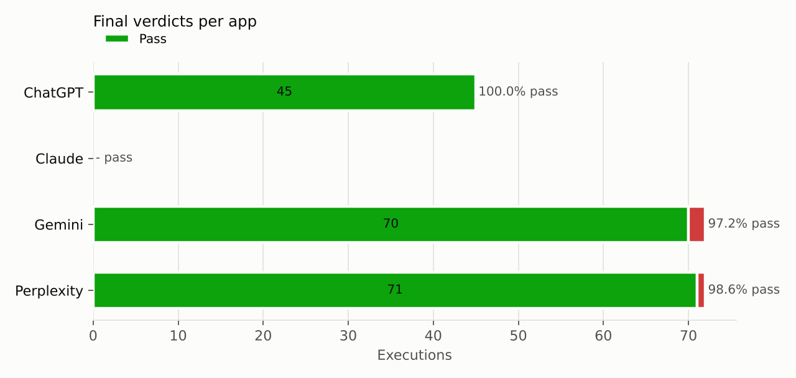
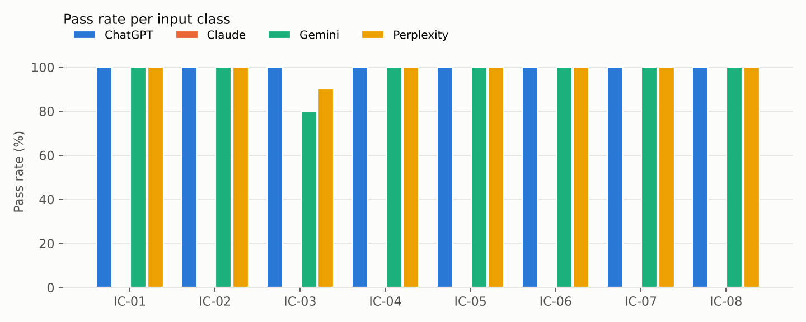

# Question/Answering test automation results

Generated by qa_report.py from run_20261122_201114, run_cloud_gemini_perplexity.

## Run overview

| runs | plan | apps | repeats | tests in plan | executions planned | executions recorded | graded | ok | timeout | blocked | error | judge | wall clock min |
|---|---|---|---|---|---|---|---|---|---|---|---|---|---|
| run_20261122_201114, run_cloud_gemini_perplexity | 3d | ChatGPT, Claude, Gemini, Perplexity | 2 | 36 | 288 | 262 | 189 | 189 | 0 | 2 | 71 | unavailable | 92.6 |

## Results per app

| group | executed | pass | partial | fail | review | not run | pass rate | pass or partial |
|---|---|---|---|---|---|---|---|---|
| ChatGPT | 45 | 45 | 0 | 0 | 0 | 1 | 100.0% | 100.0% |
| Claude | 0 | 0 | 0 | 0 | 0 | 72 | - | - |
| Gemini | 72 | 70 | 0 | 2 | 0 | 0 | 97.2% | 97.2% |
| Perplexity | 72 | 71 | 0 | 1 | 0 | 0 | 98.6% | 98.6% |
| Total | 189 | 186 | 0 | 3 | 0 | 73 | 98.4% | 98.4% |

## Executions not run, and why

| app | status | executions | reason |
|---|---|---|---|
| ChatGPT | blocked | 1 | the site's message limit was reached |
| ChatGPT | not started | 26 | the runner stopped this app before these executions (see the rows above) |
| Claude | blocked | 1 | the site showed a human check (verify you are human) to the automated browser |
| Claude | error | 71 | the browser window was closed, so nothing could be typed |

## Passes per test case and app (passed / executed)

| test | requirements | ChatGPT | Claude | Gemini | Perplexity | total pass | pass rate |
|---|---|---|---|---|---|---|---|
| TC-QA-01 | QA-01,QA-05 | 8/8 | 0/0 | 8/8 | 8/8 | 24/24 | 100.0% |
| TC-QA-02 | QA-02 | 10/10 | 0/0 | 10/10 | 10/10 | 30/30 | 100.0% |
| TC-QA-03 | QA-03 | 5/5 | 0/0 | 8/10 | 9/10 | 22/25 | 88.0% |
| TC-QA-04 | QA-05,QA-08 | 4/4 | 0/0 | 8/8 | 8/8 | 20/20 | 100.0% |
| TC-QA-05 | QA-01,QA-08 | 4/4 | 0/0 | 8/8 | 8/8 | 20/20 | 100.0% |
| TC-QA-06 | QA-04 | 4/4 | 0/0 | 8/8 | 8/8 | 20/20 | 100.0% |
| TC-QA-07 | QA-06 | 5/5 | 0/0 | 10/10 | 10/10 | 25/25 | 100.0% |
| TC-QA-08 | QA-07 | 5/5 | 0/0 | 10/10 | 10/10 | 25/25 | 100.0% |

## Results per input class (3D model: input)

| group | executed | pass | partial | fail | review | not run | pass rate | pass or partial |
|---|---|---|---|---|---|---|---|---|
| QA-IC-01 | 24 | 24 | 0 | 0 | 0 | 8 | 100.0% | 100.0% |
| QA-IC-02 | 30 | 30 | 0 | 0 | 0 | 10 | 100.0% | 100.0% |
| QA-IC-03 | 25 | 22 | 0 | 3 | 0 | 11 | 88.0% | 88.0% |
| QA-IC-04 | 20 | 20 | 0 | 0 | 0 | 8 | 100.0% | 100.0% |
| QA-IC-05 | 20 | 20 | 0 | 0 | 0 | 8 | 100.0% | 100.0% |
| QA-IC-06 | 20 | 20 | 0 | 0 | 0 | 8 | 100.0% | 100.0% |
| QA-IC-07 | 25 | 25 | 0 | 0 | 0 | 10 | 100.0% | 100.0% |
| QA-IC-08 | 25 | 25 | 0 | 0 | 0 | 10 | 100.0% | 100.0% |
| Total | 189 | 186 | 0 | 3 | 0 | 73 | 98.4% | 98.4% |

## Results per context class (3D model: context)

| group | executed | pass | partial | fail | review | not run | pass rate | pass or partial |
|---|---|---|---|---|---|---|---|---|
| QA-CX-01 | 147 | 145 | 0 | 2 | 0 | 57 | 98.6% | 98.6% |
| QA-CX-02 | 42 | 41 | 0 | 1 | 0 | 16 | 97.6% | 97.6% |
| Total | 189 | 186 | 0 | 3 | 0 | 73 | 98.4% | 98.4% |

## Observed output classes (3D model: output)

| output class | name | verdict | ChatGPT | Claude | Gemini | Perplexity | total |
|---|---|---|---|---|---|---|---|
| QA-OC-01 | Accurate, relevant and complete | Pass | 40 | 0 | 60 | 61 | 161 |
| QA-OC-02 | Nonexistent subject identified | Pass | 5 | 0 | 10 | 10 | 25 |
| QA-OC-03 | Accurate but incomplete | Partial Pass | 0 | 0 | 0 | 0 | 0 |
| QA-OC-04 | Accurate but unfocused | Partial Pass | 0 | 0 | 0 | 0 | 0 |
| QA-OC-05 | Inaccurate | Fail | 0 | 0 | 2 | 1 | 3 |
| QA-OC-06 | Fabricated | Fail | 0 | 0 | 0 | 0 | 0 |
| QA-OC-07 | Irrelevant or misses most key points | Fail | 0 | 0 | 0 | 0 | 0 |

## Results per augmentation type

| group | executed | pass | partial | fail | review | not run | pass rate | pass or partial |
|---|---|---|---|---|---|---|---|---|
| ORIG | 84 | 82 | 0 | 2 | 0 | 33 | 97.6% | 97.6% |
| PARA | 42 | 42 | 0 | 0 | 0 | 16 | 100.0% | 100.0% |
| NOISE | 42 | 42 | 0 | 0 | 0 | 16 | 100.0% | 100.0% |
| PARAM | 21 | 20 | 0 | 1 | 0 | 8 | 95.2% | 95.2% |
| Total | 189 | 186 | 0 | 3 | 0 | 73 | 98.4% | 98.4% |

## Results per test complexity level

| group | executed | pass | partial | fail | review | not run | pass rate | pass or partial |
|---|---|---|---|---|---|---|---|---|
| Low | 54 | 54 | 0 | 0 | 0 | 18 | 100.0% | 100.0% |
| Medium | 65 | 65 | 0 | 0 | 0 | 26 | 100.0% | 100.0% |
| High | 70 | 67 | 0 | 3 | 0 | 29 | 95.7% | 95.7% |
| Total | 189 | 186 | 0 | 3 | 0 | 73 | 98.4% | 98.4% |

## Repeatability: same verdict on every repeat

| app | tests with 2plus repeats | same verdict every repeat | stability |
|---|---|---|---|
| ChatGPT | 9 | 9 | 100.0% |
| Claude | 0 | 0 | - |
| Gemini | 36 | 34 | 94.4% |
| Perplexity | 36 | 35 | 97.2% |
| Total | 81 | 78 | 96.3% |

## Tests whose verdict changed between repeats

| app | test | verdicts |
|---|---|---|
| Gemini | QA-03-ORIG-CX01 | Fail / Pass |
| Gemini | QA-03-ORIG-CX02 | Pass / Fail |
| Perplexity | QA-03-PARAM-CX01 | Pass / Fail |

## Automatic validation

| graded by oracle | also graded by judge | agreed | agreement rate | review raised | review decided by hand | review still open | body diff extractions | key point checks run |
|---|---|---|---|---|---|---|---|---|
| 189 | 0 | 0 | - | 0 | 0 | 0 | 0 | 513 |

## Defects found (Fail and Partial Pass)

| app | test | repeat | verdict | output class | why |
|---|---|---|---|---|---|
| Gemini | QA-03-ORIG-CX01 | 1 | Fail | QA-OC-05 | gives conflicting results: 254629.6, 254600.0 bps next to 262306 bps |
| Perplexity | QA-03-PARAM-CX01 | 2 | Fail | QA-OC-05 | final rate 461651 bps is not within 1% of 704318 bps |
| Gemini | QA-03-ORIG-CX02 | 2 | Fail | QA-OC-05 | gives conflicting results: 255585.6, 255600.0 bps next to 262306 bps |

## Execution time

| app | executions | mean response s | median response s | p90 response s | max response s | mean execution s | sum execution min | mean words |
|---|---|---|---|---|---|---|---|---|
| ChatGPT | 45 | 8.6 | 6.3 | 17.2 | 19.6 | 37.9 | 28.4 | 192.8 |
| Claude | 0 | - | - | - | - | - | - | - |
| Gemini | 72 | 18.7 | 17.1 | 23.6 | 44.0 | 46.6 | 55.9 | 248.3 |
| Perplexity | 72 | 7.5 | 6.8 | 11.8 | 15.3 | 32.7 | 39.3 | 143.3 |
| All | 189 | 12.0 | 11.1 | 20.3 | 44.0 | 39.2 | 123.6 | 195.1 |

## Test automation cost

| item | value | basis |
|---|---|---|
| Development effort (scripts, data, oracle) | 9.5 h | own time log |
| Code written | 1851 LOC in 7 scripts + 188 LOC unit tests | measured (non-blank, non-comment, no docstrings) |
| Executions that got an answer | 189 | measured |
| Messages sent to chatbots | 315 | measured (test prompts + context fillers) |
| Machine time, wall clock | 92.6 min | measured (apps in parallel) |
| Machine time, sequential sum | 123.6 min | measured |
| Judge (Ollama) time | 0.0 min | measured, local model |
| Same work done by hand | 567 min | assumption: 3.0 min per execution (type, wait, read, grade, record) |
| Human time with automation | 30 min | assumption: 15 min setup per run + 1.5 min per REVIEW item |
| Human time saved per run | 268 min | manual minus automated |
| Break-even point | 2.1 runs | development time / time saved per run |
| Money spent | $0.00 | given with --dollars (plans, API) |

## Test script complexity

| file | total lines | loc | functions | avg cc | max cc | most complex | role |
|---|---|---|---|---|---|---|---|
| qa_generate.py | 347 | 291 | 13 | 7.7 | 20 | validate (20) | script |
| qa_oracle.py | 524 | 402 | 25 | 6.9 | 19 | _check_command (19) | script |
| qa_judge.py | 157 | 117 | 6 | 4.5 | 12 | cmd_regrade (12) | script |
| qa_sites.py | 92 | 65 | 2 | 3.0 | 3 | is_site_error (3) | script |
| qa_runner.py | 544 | 452 | 21 | 7.4 | 20 | cmd_run (20) | script |
| qa_review.py | 70 | 52 | 2 | 11.5 | 19 | main (19) | script |
| qa_report.py | 554 | 472 | 27 | 8.9 | 29 | charts (29) | script |
| test_qa_oracle.py | 155 | 115 | 8 | 2.4 | 3 | test_param_counter_expected_value (3) | unit test |
| test_qa_generate.py | 62 | 43 | 7 | 4.9 | 12 | test_noise_keeps_technical_tokens (12) | unit test |
| test_qa_report.py | 43 | 30 | 4 | 4.2 | 7 | test_verdict_table_counts_and_rates (7) | unit test |
| qa_model_3d.json | 258 | 258 | - | - | - | - | test data |
| qa_test_data.json | 168 | 168 | - | - | - | - | test data |

## Test case complexity

| test | input class | level | variants | turns cx01 | turns cx02 | key point checks | error checks | oracle |
|---|---|---|---|---|---|---|---|---|
| TC-QA-01 | QA-IC-01 | Low | 3 | 1 | 4 | 2 | 2 | getbulk_version |
| TC-QA-02 | QA-IC-02 | Low | 4 | 1 | 4 | 2 | 3 | oid_unit |
| TC-QA-03 | QA-IC-03 | High | 4 | 1 | 4 | 2 | 3 | counter_wrap |
| TC-QA-04 | QA-IC-04 | Medium | 3 | 1 | 4 | 2 | 3 | udp_reasons |
| TC-QA-05 | QA-IC-05 | Medium | 3 | 1 | 4 | 2 | 4 | trap_inform |
| TC-QA-06 | QA-IC-06 | High | 3 | 1 | 4 | 5 | 2 | snmpv3_levels |
| TC-QA-07 | QA-IC-07 | Medium | 4 | 1 | 4 | 5 | 8 | snmp_command |
| TC-QA-08 | QA-IC-08 | High | 4 | 1 | 4 | 2 | 3 | nonexistent |

## Test coverage

| item | covered | rate |
|---|---|---|
| Requirements | 8 of 8 | 100.0% |
| Decision rules | 8 of 8 | 100.0% |
| Input classes | 8 of 8 | 100.0% |
| Context classes (session) | 2 of 2 | 100.0% |
| Apps | 3 of 4 | 75.0% |
| Augmentation types | 4 of 4 | 100.0% |
| Expected output classes tested | QA-OC-01, QA-OC-02 | - |
| Output classes observed | 3 of 7 (QA-OC-01, QA-OC-02, QA-OC-05) | 42.9% |
| 3D cells (app x context x input) in the plan | 48 of 64 | 75.0% |
| 3D cells of the full model | 48 of 64 | 75.0% |
| Executions graded | 189 of 288 | 65.6% |

